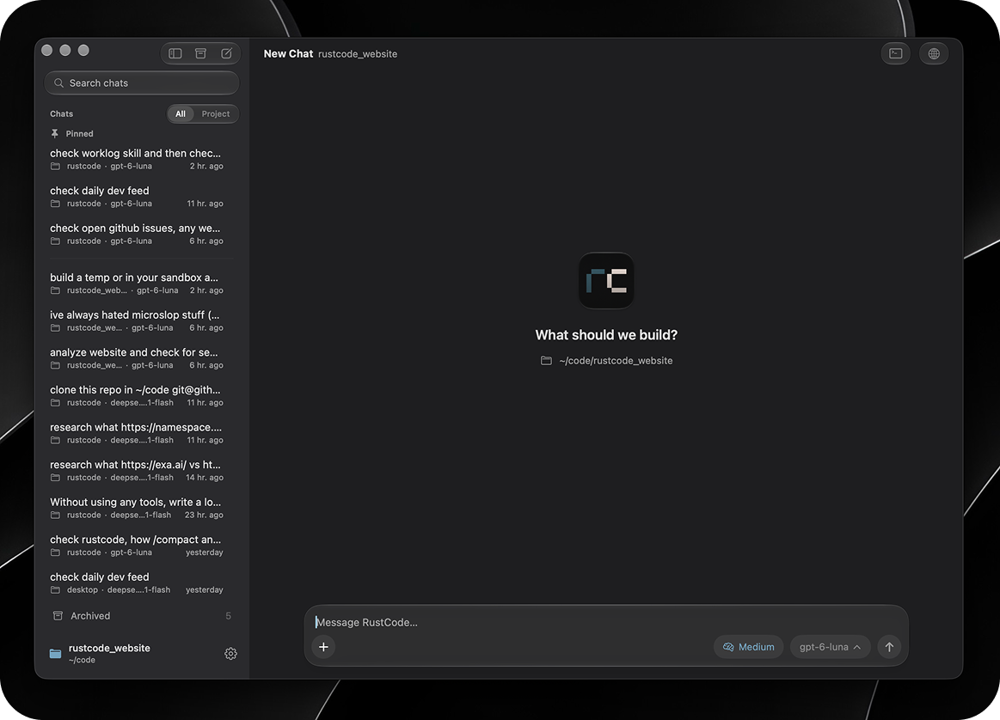
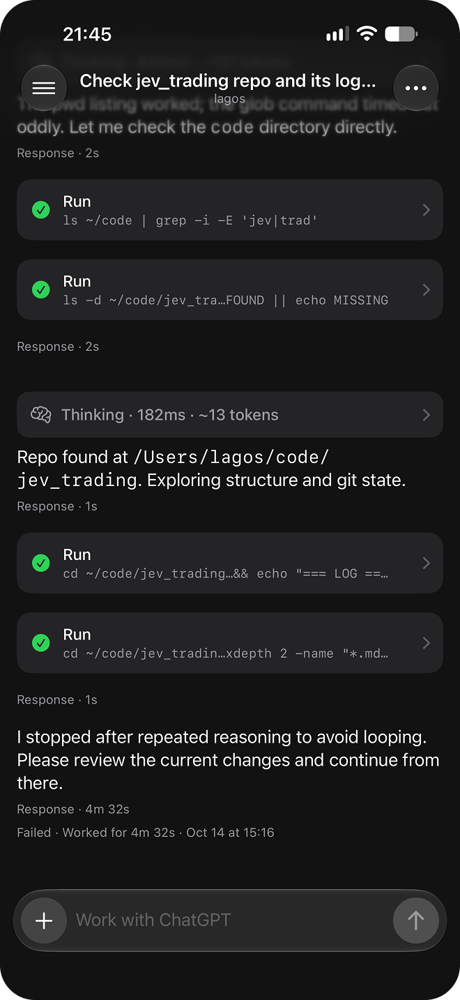

<p align="center">
  
</p>

<h1 align="center">RustCode</h1>

<p align="center">
  A coding agent made in Rust: terminal, desktop and iPhone.<br/>
  <a href="https://rustcode.lhagfoss.com">rustcode.lhagfoss.com</a>
</p>

<p align="center">
  
</p>

<p align="center">
  
  &nbsp;
  
</p>

## Install

```bash
curl -fsSL https://rustcode.lhagfoss.com/install.sh | bash        # macOS, Linux
irm https://rustcode.lhagfoss.com/install.ps1 | iex               # Windows
brew tap lhagfoss/tap && brew trust lhagfoss/tap && brew install rustcode
```

From source: `cargo install --path rustcode/tui`. More in the
[install guide](docs/install.md).

## Use

```bash
rustcode                     # TUI in the current project
rustcode --prompt "…"        # one prompt, no TUI
rustcode --resume            # continue the last thread here
rustcode --acp               # ACP server over stdio
```

Sign in with `/login` (ChatGPT, API keys), `/login github-copilot` or
`/login anthropic`; switch models with `/model`.

## What it does

- **Any model**: Ollama, OpenAI-compatible APIs, Anthropic, ChatGPT and
  Copilot plans.
- **Any harness**: run a thread on RustCode's own engine, Codex, Claude Code,
  Gemini CLI or OpenCode ([harnesses](docs/harnesses.md)).
- **Safe tools**: edits, shell and search with approvals and an OS sandbox.
- **Agents**: subagents, background tasks, MCP servers and skills.
- **Desktop app**: Tauri + React, in [`apps/desktop`](docs/desktop.md).

## Docs

[Configuration](docs/configuration.md) ·
[Providers](docs/provider-auth.md) ·
[Harnesses](docs/harnesses.md) ·
[Desktop](docs/desktop.md) ·
[Sandbox](docs/sandbox.md) ·
[Subagents](docs/multi-agent.md) ·
[ACP](docs/acp.md) ·
[Remote](docs/remote.md) ·
[Architecture](docs/architecture.md)

## Contributing

See [CONTRIBUTING.md](CONTRIBUTING.md) and [SECURITY.md](SECURITY.md).
Licensed under [Apache 2.0](LICENSE).
