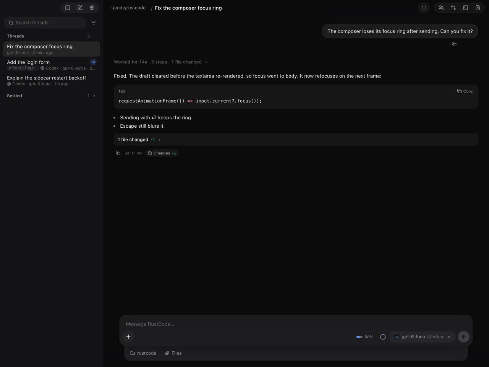

<p align="center">
  
</p>

<h1 align="center">RustCode</h1>

<p align="center">
  One app for your coding agents.<br/>
  <a href="https://rustcode.lhagfoss.com">rustcode.lhagfoss.com</a>
</p>

<p align="center">
  
</p>

RustCode is the orchestrator for your coding agents: one app and one `rustcode`
command that run Claude Code, Codex, Gemini CLI, OpenCode, Pi or RustCode's
built-in harness, and keep every thread, project, setting and usage figure in
one place. Each thread picks its agent, model and effort, can run in its own git
worktree, and an agent can start and message other threads.

## Install

```bash
curl -fsSL https://rustcode.lhagfoss.com/install.sh | bash   # macOS, Linux
irm https://rustcode.lhagfoss.com/install.ps1 | iex          # Windows
```

This installs two things: the **RustCode app**, the orchestrator, and the
**`rustcode` command**: the terminal UI and the built-in harness it runs.
Details and other options are in the [install guide](docs/install.md).

## What you get

- **Every agent, one place.** Sign in to each agent once; switch harness,
  model and effort per thread ([harnesses](docs/harnesses.md)).
- **Work in parallel.** Worktree threads, a live sidebar of what runs and
  what waits for you, fan-out and compare ([orchestrator](docs/orchestrator.md)).
- **Stay in control.** Approvals, per-turn checkpoints, review of every
  change before it lands.
- **A local agent too.** `rustcode` runs on any model, including local ones
  through Ollama, with an OS sandbox ([providers](docs/provider-auth.md)).

## The `rustcode` command

```bash
rustcode                 # the terminal UI in this project
rustcode --prompt "…"    # one prompt on the built-in harness, no UI
rustcode --acp           # serve ACP over stdio (the app uses this)
```

## Docs

[Desktop app](docs/desktop.md) ·
[Harnesses](docs/harnesses.md) ·
[Orchestrator](docs/orchestrator.md) ·
[Configuration](docs/configuration.md) ·
[Sandbox](docs/sandbox.md) ·
[Architecture](docs/architecture.md)

Contributing: [CONTRIBUTING.md](CONTRIBUTING.md) ·
Security: [SECURITY.md](SECURITY.md) ·
License: [Apache 2.0](LICENSE)
